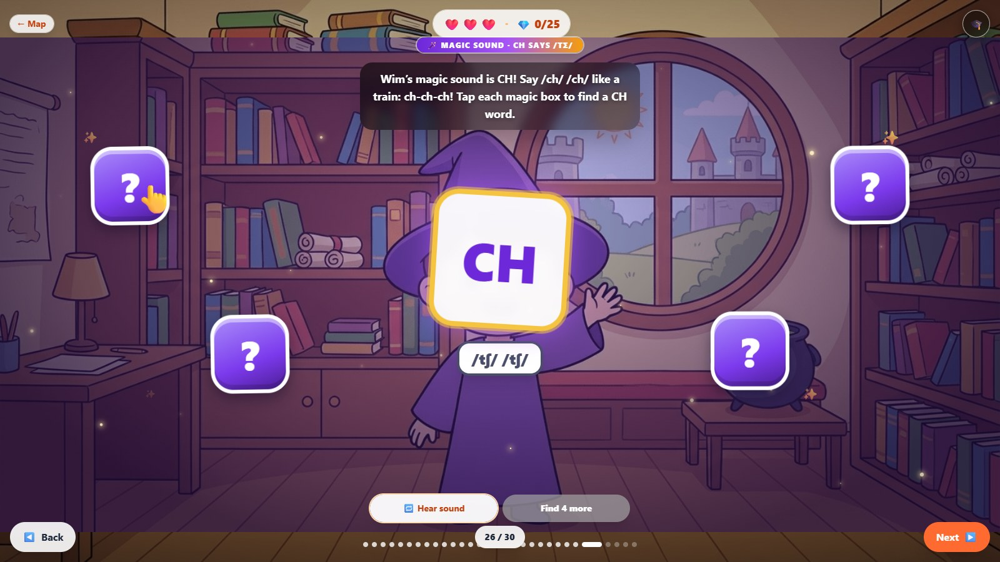

# EnglEuphoria

**Live English lessons with real teachers, plus game-like story lessons, for children, teens and adults, with AI used where it helps and humans where it matters.**

Founder: Fatima Zahra Djaanine · founder@engleuphoria.com · [www.engleuphoria.com](https://www.engleuphoria.com)

> This repository is an **evaluation showcase**. The full production code, lesson content and artwork are private. Everything here is representative of how the real platform is built and the standards it follows. A live demo of the full product is available on request.

---

## The problem

People learning English online usually get one of two things: a game with no teacher, or a video call with no structure. Families and adults in many regions also struggle to find lessons in their own language, at fair prices, and, for children, in a safe place.

## What EnglEuphoria does

- **Live lessons** with a real teacher, built around a story world with a small cast of friendly characters.
- **A complete curriculum**, from first words (Pre-A1) to upper B2, with the same speaking-first method at every level.
- **Learning spaces by age:** Playground for children, Academy for teens, and Success for adults.
- **Three spaces in one platform:** child, parent and teacher, each with its own simple screen.
- **Six languages for families:** English, Arabic, French, Spanish, Italian and Turkish.
- **Safe by design:** parent-managed child profiles, calm content, no public rankings, no pressure.

## How to see it

**This repository does not run, on purpose.** It holds the README, three code excerpts and screenshots. The full code is private.

To see the real product, open the live site: **https://www.engleuphoria.com**

1. Sign in with the **judge test accounts** (child, parent and teacher) given in the competition submission form.
2. Child view: open a lesson from the learning map.
3. Parent view: see several children and their progress in one dashboard.
4. Teacher view: open the lesson library and the live classroom.

A walkthrough video is included in the competition submission. No credentials are stored in this repository.

## How the real app runs (for reference)

The full application is a private codebase, so the commands below will not work from this repository. They show how the real app is set up:

**Stack:** React 18 · TypeScript · Vite · Tailwind CSS · Framer Motion · Supabase (accounts, database, realtime, server functions).

```bash
npm install
npm run dev        # http://localhost:8080
npm test           # unit tests
```

The app needs a few private environment values (a backend URL and a public client key) in a local `.env` file. These are not published. Access to the full source can be arranged with the founder under an agreement: founder@engleuphoria.com.

## Who built what

| Part | Built by |
|---|---|
| Product idea, curriculum and lesson design, teaching method | Fatima Zahra Djaanine |
| Web app: child, parent, teacher spaces and live classroom | Fatima Zahra Djaanine, working with an AI coding assistant (Claude Code) |
| Content: story worlds, voices, pictures | Fatima Zahra Djaanine, using AI generation tools, with every item reviewed and approved by hand |
| Quality rules, child-safety checks, testing | Fatima Zahra Djaanine |

EnglEuphoria is a solo-founder project. AI tools speed up the work; every design decision and release is made and checked by the founder.

## Screens

| | |
|---|---|
|  |  |
| Live classroom: video, shared lesson screen, chat, teacher tools | Child home: a learning map with one clear next step |
|  |  |
| Parent dashboard: several children, each with their own profile | A lesson opens in a story world |
|  |  |
| Place a character, then say where he is | Match and sort activity |
|  | |
| Sound activity: tap the magic boxes to find words with the sound | |

Student names are not shown in any screenshot.

## Where AI is used

AI is a tool in the content pipeline and the learning experience, never a replacement for the teacher.

| Area | How AI helps | Human control |
|---|---|---|
| **Voices** | Natural recorded character voices are generated ahead of time, so every child hears the same clear model | Each voice and line is checked for accent and pronunciation before release |
| **Lesson creation** | AI assists with drafting activities and pictures inside a fixed lesson design | Every lesson passes a written quality checklist before children see it |
| **Learner help** | A rule-based help assistant answers parent and student questions in five languages | Answers come from a reviewed guide |
| **Safety** | Automatic checks reject content that breaks child-safety rules | Rules are written by the founder, a teacher |

**Principles we hold ourselves to**
1. **No live voice dependency.** Lesson audio is pre-generated and cached, so lessons work reliably and cost little.
2. **One voice standard.** Every voice a child hears is a standard native English voice saying each word correctly. A guard blocks any device voice from being used.
3. **Child-safe media.** Generated pictures and video follow a written gate: a brief, an automatic lint, owner approval, then one test item before anything more is made.
4. **Comfort first.** The student must always see and reach everything on screen. Screens are tested in a real browser.

## Architecture (high level)

See [docs/architecture.md](docs/architecture.md).

## Code samples

Three short files show the style and care behind the platform:

- [`code-samples/speechPolicy.ts`](code-samples/speechPolicy.ts): the rules that clean every line before it is spoken (numbers, abbreviations, symbols, emoji) and flag sounds a voice cannot say. The list of approved voices is private and removed.

- [`code-samples/noBrowserVoice.ts`](code-samples/noBrowserVoice.ts): a startup guard that reroutes any device text-to-speech call to the platform's recorded voices, so no child ever hears a wrong accent.
- [`code-samples/DialoguePlate.tsx`](code-samples/DialoguePlate.tsx): the accessible, theme-aware dialogue component used across story lessons.

They are excerpts: some imports point to private modules, so they will not build on their own.

## Status

- **Pre-A1:** 72 lessons in 10 units, built on the same unit structure used across the course.
- **Academy (teens):** first series in progress, with 60-minute lessons.
- **Launched** in October 2026.

## Before and during the programme

EnglEuphoria was an existing platform before the programme, with student, teacher and admin dashboards, a live classroom, a credit system and the first Playground lessons. During the programme I added the Academy hub, family accounts with a parent-managed child picker, the recorded native-voice system with its pronunciation policy, a gated pipeline for lesson art and video, pages in six languages and a homework quest system.

## Next three months

1. Finish Unit 1 of the Academy A1 series (six 60-minute lessons) for teens.
2. Add speech recognition so learners get instant feedback on pronunciation.
3. Launch a shared family credit wallet, so parents can share lessons across their children.
4. Pilot with real families and teachers, measure lesson completion and speaking time, and fix what the data shows.
5. Pre-generate all Academy and adult-space audio so lessons load fast and cost less to run.

## What is not in this repository

Lesson content, characters and artwork, voice and audio files, the full database design, prompts and the complete source code are private. This is intentional.

## License and use

Copyright © EnglEuphoria. **All rights reserved.** This repository is shared for evaluation only. You may read it for that purpose. You may not copy, modify, redistribute or use any part of it commercially without written permission. See [LICENSE](LICENSE).
