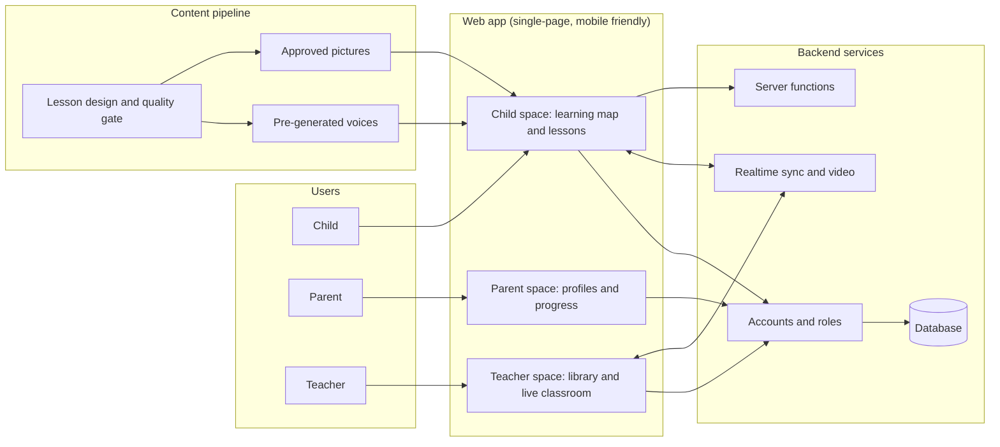

# Architecture overview

A high-level view of how EnglEuphoria fits together. Details such as schemas, prompts and configuration are intentionally not included.

## Main ideas

- **One app, three roles.** The same web app shows a child, parent or teacher space depending on the signed-in role.
- **Live classroom.** Teacher and child share one lesson screen with video, chat and tools. State is synced in real time, and the lesson survives a dropped connection.
- **Content first, then ship.** Lessons are authored once to a fixed shape (a unit has several lessons, each follows the same loop), checked against a written quality list, and only then published.
- **Pre-generated audio.** Voices are made ahead of time and cached. The app plays a stored clip and stays silent if one is missing, so a child never hears the wrong voice.
- **Safety in the foundation.** Parent-managed profiles, role-based access and automatic content checks sit under every screen.
- **Translations.** Family-facing pages are available in Arabic, French and English, with the family's own choice always respected.
